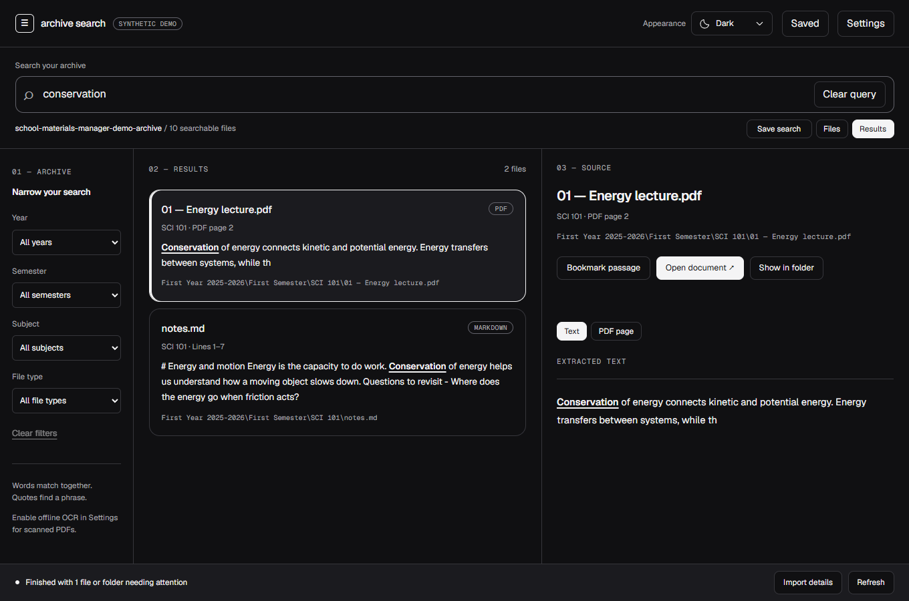

# Archive Search

**Find the part you remember.**

I built Archive Search to find things in my school materials without uploading them. It is a Windows desktop app that searches passages in PDFs, Word documents, slides, notes and code, then shows where each match came from. Your original files stay untouched.



This is a personal, experimental open-source project, shared under the [MIT license](LICENSE). Version 0.3.0 is available as source; no downloadable app or Google OAuth client configuration is included in this release. Windows 11 x64 is the tested development platform. See [validation and known limits](RELEASE_CHECKLIST.md).

## What it does

- Search keywords and quoted phrases across PDF, DOCX, PPTX, Markdown, text and supported code files.
- See PDF pages, Word paragraph numbers, slide numbers or line ranges beside results.
- Browse indexed files or the current archive, with academic and file-type filters in indexed views.
- Save searches and bookmark passages across restarts and index rebuilds.
- Search, render PDFs and optionally run Windows OCR locally. OCR is off by default.
- Use light, dark or system appearance, keyboard navigation and reduced motion.

Screenshots and test archives use original synthetic material. No real school archive content is included.

## Run from source

Use Windows x64 and Node.js 24.14.1 or newer. Windows PowerShell 5.1 supplies Office parsing and Windows OCR. The PDF process supervisor requires a compatible .NET Framework compiler/runtime and Windows atomic Job List support; unavailable containment refuses PDF parsing. Microsoft Office and Tesseract are not required.

```powershell
npm ci
npm start
```

To try the synthetic demo after building:

```powershell
.\node_modules\electron\dist\electron.exe . --demo
```

1. Choose an archive folder, review it and select **Start indexing**.
2. Search a concept, filename, identifier or `"exact phrase"`. Words match together; phrases stay within one passage.
3. Filter by year, semester, subject and file type. Unfamiliar folder layouts appear under **Other**.
4. Select a match to read its text and source location. Use **PDF page** for a local page preview.
5. Use **Refresh** after changing files. **Import details** reports partial, no-text, unchanged and failed files. **Stop indexing** preserves committed work.

**Open document** uses the Windows default application for PDF, Markdown or plain text. Office files, code and scripts offer **Show in folder** without executing the source.

## Collection is optional

Local search needs no account. **Collect** can import files you have downloaded into a separately managed `Collected` subtree, retaining versions and verifying copies before indexing them.

The Google Classroom connector is experimental and requires your own Desktop OAuth configuration. No publisher client, credentials or account grants are included. Automatic Drive attachment downloads require a separate broad read-only permission. Live Google access and a real-course pilot have not been validated. UVEC automatic collection requires a school-approved restricted Moodle read service; use manual downloads when that service is unavailable. Other schools can use manual import too.

See [collection setup and permissions](COLLECTION_SETUP.md). Connect only accounts and materials you are permitted to access and retain. The app does not change submissions, grades or course completion. An optional daily schedule runs only while the app is open. Local course-code suggestions and attributed excerpts require confirmation; no AI service or content-upload backend is included.

## Navigation and saved items

An empty query opens **Files**. Enter folders, use breadcrumbs or **Up**, and switch between **Files / Results** without losing each view's position. Search covers the whole archive with the chosen filters.

**Indexed files** works from stored paths even while the archive is disconnected. **All archive files** reads the current directory and includes unsupported files and files awaiting Refresh; filters pause in this mode. Hidden/system entries, links, dependency folders, build output and caches remain excluded. Listings show 50 entries per page; live reads stop at 10,000 entries and mark larger directories incomplete.

**Save search** remembers the query and filters. **Bookmark passage** remembers its location and a text fingerprint. Open **Saved** to return to either. Changed or missing passages produce a message instead of silently opening another match. Up to 500 saved items are kept separately from disposable indexes in `data/saved.json`.

Ctrl+K focuses search; arrow keys, Home/End and Enter navigate rows; Alt+Up moves up a folder. Tab stays inside dialogs and Escape dismisses them. See [interaction guidelines](INTERACTION_GUIDELINES.md) for details.

## PDF preview and OCR

The PDF viewer has page navigation and fit-width/150%/200% zoom. It renders pixels locally; links, forms, attachments and PDF scripts are not interactive. **Text** returns to the indexed passage.

Enable **offline OCR** in Settings, then Refresh, to recognize textless PDF pages using installed Windows languages. Check recognized wording against the original. The app downloads no language packs. OCR attempts the first 20 textless pages per PDF within a 120-second file deadline; Office images and pages with embedded text are outside this feature. Rotation can prevent recognition. Failed replacements retain previously indexed text with a stale warning.

PDF extraction and preview run in separate Windows Job Object processes, with 384 MiB committed memory per process, 512 MiB per parser job, eight processes per job and two concurrent parser jobs. Missing containment fails closed. These limits constrain allocations; they are not a total physical-memory guarantee or a filesystem/network sandbox.

## Your files and local data

Search does not edit, rename, move or delete originals. Refresh reuses unchanged files; **Rebuild index** creates a replacement and preserves the active index if rebuilding fails or is cancelled. An inaccessible archive retains its stored results. Back up your archive and app data before upgrades or downgrades.

Runtime data lives in `%APPDATA%\school-materials-manager`. Preferences, saved items, collection records and SQLite indexes stay local. Indexes contain extracted private content and are **not encrypted**. Earlier indexes, backups and sync history can retain text.

Settings offers **Clear local data** with a scope review and a separate Windows confirmation. It preserves originals and changed/unverified managed files. Disconnect removes connection/schedule material and attempts provider revocation while retaining collected files and indexes. Ordinary deletion does not guarantee forensic erasure.

Read the [privacy policy](PRIVACY.md) and [security notes](SECURITY.md). Do not attach credentials, private documents or student records to bug reports.

## Supported formats and limits

Supported extensions: `.pdf`, `.docx`, `.pptx`, `.md`, `.txt`, `.c`, `.h`, `.cpp`, `.py`, `.kt`, `.js`, `.ts`. Legacy Office files, spreadsheets, macro-enabled Office files and ZIP archives are not extracted.

- PDFs: 32 MiB and 1,000 pages. Preview images are capped at roughly four megapixels and 2,400 pixels per side.
- DOCX/PPTX: 32 MiB, 5,000 ZIP entries and 64 MiB declared expanded content. Extraction covers Word body paragraphs and slide shape text; headers, footers, notes, embedded files and images are outside coverage.
- Text/code: 2 MiB, UTF-8 or BOM-marked UTF-16. Extracted text is capped at two million characters per file.
- Passages contain up to 4,000 characters or 80 lines. Queries allow 500 characters and 32 terms, with exact tokens and no stemming or typo correction. Results show 25 grouped files per page and up to 25 additional matches per file.

Multiple active archives, fuzzy search, web hosting and AI are deferred.

## Development and validation

```powershell
npm test
npm run smoke
```

For isolated UI checks, supply an already-installed Playwright module and Chrome:

```powershell
npm run build
node scripts/verify-ui.mjs 'C:/path/to/playwright/index.mjs'
```

The runner uses synthetic archives and separate app data, runs seven UI suites and writes `output/playwright/ui-qa.json`. A fresh install and build of this public source snapshot passed 108/108 automated tests with no skips, and all seven UI suites passed on the Windows 11 x64 development host. That evidence does not establish clean-device compatibility, physical-offline behavior, audible screen-reader quality or live Google/UVEC access. The [release checklist](RELEASE_CHECKLIST.md) separates source publication from those later checks.

To build your own unsigned portable folder, run `npm run package`. The complete output is under `out/release-0.3.0/school-materials-manager-win32-x64`; keep the folder together. Packaging refuses an existing output directory. This repository does not publish that binary.

The application code uses [MIT](LICENSE). Bundled dependencies retain their own terms in [third-party notices](THIRD_PARTY_NOTICES.txt) and `licenses/native/`, including supplied source packages for MPL-covered native dependencies. After a dependency update, refresh the native inventory with `python scripts/collect-native-licenses.py` and review its versions and hashes.
